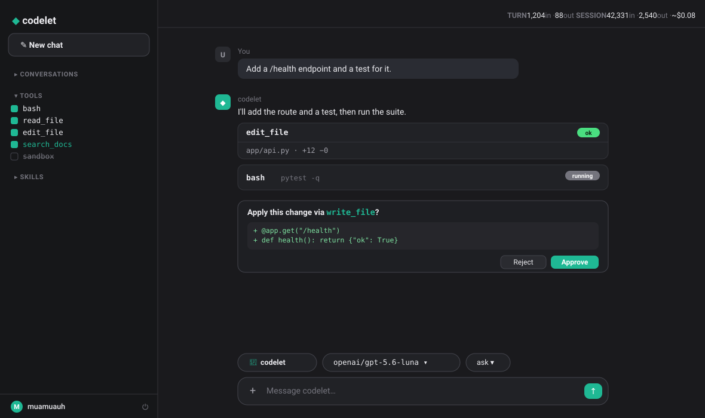

# codelet

一个轻量级 AI 编码助手框架。核心是异步 agent loop + 工具系统 + 权限门控，外加一整套
工程化能力：**SubAgent / 并行执行 / Skill 系统 / Hooks / 上下文自动压缩 / Token & 成本
遥测 / 多 LLM 提供方（Anthropic / OpenAI / DeepSeek / 任意 OpenAI 兼容中转站）/
Session 持久化 / Slash 命令模板 / Diff 预览**。

设计目标：核心代码 ≤ ~3000 行，每一处都讲清楚为什么这样写。

> 🚀 详细使用见 [USAGE.md](USAGE.md)（Windows + miniconda 实操指南）。

📚 **文档**（[docs/](docs/) 下的索引见 [docs/README.md](docs/README.md)）：

- [架构图](docs/architecture.md) — 模块责任划分 + 扩展点
- [运行时流程图](docs/flow-diagrams.md) — 9 张 mermaid 时序图覆盖关键路径
- [技术细节深入](docs/technical-details.md) — 12 个有坑的实现点
- [面试式 Q&A](docs/interview-qa.md) — 30 个设计权衡问题
- [实现路线图](docs/implementation-plan.md) — phase 划分
- [插件架构](docs/plugin-architecture.md) — 插件接口 + 内置 sandbox / rag / **evolve 自进化** / **memory 跨会话记忆** / **router 意图路由**（P8 / P9 / P11 / P12）

## 当前进度

- [x] **P1** 核心骨架 + LLM 抽象层（6 工具、agent loop、2 层权限、context、Rich REPL）
- [x] **P2** 异步化 + 并行 dispatch（`Tool.aexecute` + `asyncio.gather` + 顺序保持 + 错误隔离）
- [x] **P3** Subagent + Skill + TodoWrite（深度上限 2、上下文隔离、并行 Task、按需 skill 加载）
- [x] **P4** Hooks + Context 压缩 + Token/成本 Telemetry + settings.json 分层加载
- [x] **P5** 多 provider profiles（Anthropic / OpenAI 兼容）+ `.env` 加载 + WebFetch + Session 持久化 + Slash 命令模板 + Diff 预览
- [x] **P6** 实时 token 流式输出 + 等待 spinner + per-project session registry（分区 `/sessions`）+ 执行式 eval 框架 + SWE-bench Lite 适配器
- [x] **P7** 本地 Web GUI（FastAPI + WebSocket + 原生前端）：流式聊天 + 工具卡片 + diff 审批 + 会话/画像/遥测，核心经 `AgentSink` 解耦
- [x] **P8** 插件系统（tool / prompt-中间件 / tool-中间件 / slash 命令 / system-prompt 段；entry-point + `.codelet/plugins/` 发现，subagent 继承；内置 **sandbox**(独立 Docker 隔离 shell 工具) 与 **rag**(BM25 检索) 插件，见 [docs/plugin-architecture.md](docs/plugin-architecture.md)）+ 图片多模态（Web 上传图片 → vision content block → OpenAI/Anthropic 客户端翻译）
- [x] **P9** 自进化（self-evolution）：内置 **evolve** 插件提供 `create_tool` 元工具 —— 对话中模型发现缺工具时自己**编写**并经插件系统**热激活**到运行中的会话（下一轮即可调用），落盘 `.codelet/evolved/` 后续启动自动重载；ASK 模式先审阅生成源码、语法/运行错误隔离、核心工具受保护，见 [docs/plugin-architecture.md · 自进化](docs/plugin-architecture.md#自进化agent-自己长出工具)
- [x] **P10** 分层上下文压缩（写入时截断 → 零 LLM 清理旧工具输出 → 七节结构化滚动摘要 → 保持配对的硬上限，token 预算以服务商 usage 为锚）+ 保留评测，见 [Context 压缩](#context-压缩p4)
- [x] **P11** 跨会话记忆：内置 **memory** 插件（有类型的 markdown 条目、索引进系统提示词、按 key 覆盖、ASK 模式 diff 审批、拒存密钥）+ 两次会话评测：会话 2 照做用户纠正的比例从 3/20 到 19/20，见 [docs/plugin-architecture.md · 记忆](docs/plugin-architecture.md#记忆下一次会话该知道的少量事实)
- [x] **P12** 意图路由：内置 **router** 插件把问答 / 规划 / 不明确的一轮设为只读（规则为主、模型兜底可选、分错只多一轮确认）；同时把 PLAN 模式从黑名单改成白名单——原来插件的写工具能穿过「只读」模式。测试集误拦 2/32、保护 41/48（加模型兜底 46/48）；端到端提问时擅自改文件 1/16 → 0/16，真要改的 8/8 不受影响。见 [docs/plugin-architecture.md · 意图路由](docs/plugin-architecture.md#意图路由只是在问的时候不改文件)
- [x] **P13** 三栏 Web 工作台 + 原生 **cockpit** 插件 + 两层能力集与 GitHub Skill 安装：
  - 动态拉取 OpenAI/ZenMux 模型目录与本地 TTL 缓存（`/models`、搜索与厂商筛选、定价与上下文窗口自动同步）
  - 内置 **cockpit** 插件（默认启用）：上下文 5 段环形监控 + 缓存命中率 + TTFT/P95/tok/s 24 轮趋势 + ZenMux PAYG 实时余额（`ZENMUX_MANAGEMENT_API_KEY`，未配置时优雅降级为本地今日/7日消费看板）
  - 四档执行模式（`normal / ask / plan / auto`）+ 五档可调思考强度（`--effort` / `/effort`：`auto / off / low / medium / high`）
  - `/btw` 独立侧栏旁路问答（不污染主上下文，主回合运行中可并发提问）+ Stop 中断 + Thinking 推理折叠卡 + `Ctrl+K` 全局命令面板 + 左右侧栏拖拽调宽
  - 两层能力集架构（上层 `Plugins · Packs` 热插拔捆绑 Tools + Skills + Commands；底层 `Tools` / `Skills` 细粒度开关）+ 目录型 `<name>/SKILL.md` + `install_skill` / `/install` 从 GitHub 安装并安全审计热重载 + 内置 `skill-creator`

测试：`335 passed`（`pytest -q`）。

## 环境

```bash
conda create -n codelet python=3.10 -y
conda activate codelet
pip install -e ".[dev]"            # 本地开发
# pip install -e ".[dev,openai,web]"  # P5 之后再启用
```

## 配 LLM 的最快路径：(base_url, api_key, model) 三元组

只要在 `.env` 里写三个变量就能跑任意 OpenAI 兼容的端点（DeepSeek / OpenRouter /
SiliconFlow / Moonshot / vLLM / Ollama / 自建中转 / 任何兼容服务）：

```bash
cp .env.example .env
```

```ini
# .env
LLM_BASE_URL=https://api.deepseek.com/v1
LLM_API_KEY=sk-xxx
LLM_MODEL=deepseek-chat
# LLM_PROVIDER=openai   # 默认；想用 Anthropic 原生时设 "anthropic"
```

跑：

```bash
python -m codelet "你好"
```

不需要碰 `settings.json`，不需要 `--profile`。换一个中转就只改这三行。

> Shell exported 的环境变量永远盖 `.env`，所以 CI / 部署里的 secret 管理工具不会被
> `.env` 文件干扰。

### 一次性传给 CLI（不写文件）

```bash
python -m codelet \
  --base-url https://api.deepseek.com/v1 \
  --api-key sk-xxx \
  --model deepseek-chat \
  "你好"
```

`--base-url` 给定但没显式 `--provider` 时自动推断为 `openai` 兼容（Anthropic 几乎不需要
改 base_url）。

### 想要切来切去 → 命名 profile

如果你常在多个 LLM 之间切，把它们放进
[`.codelet/settings.json`](.codelet/settings.json) 的 `profiles`：

```json
{
  "profiles": {
    "myproxy": {
      "provider": "openai",
      "base_url": "https://your-proxy.example/v1",
      "model": "your-model",
      "api_key_env": "MYPROXY_API_KEY"
    },
    "myproxy-inline": {
      "provider": "openai",
      "base_url": "https://your-proxy.example/v1",
      "model": "your-model",
      "api_key": "sk-paste-key-directly"
    }
  }
}
```

每条 profile 二选一：
- `api_key_env: "X"` → 从 `.env` / shell 里读 `X`（推荐，不把 secret 写进版本库）
- `api_key: "sk-..."` → 直接写明文（self-contained，单文件可分发）

切换：`python -m codelet --profile myproxy "..."`

### 解析优先级

```
CLI flags  >  --profile X  >  settings.profile  >  LLM_*(env-driven)  >  "anthropic"
```

`/profile` 命令实时显示当前激活的四元组。

## 运行

```bash
# 交互式 REPL（用 .env 里的 LLM_* 三元组，或没设的话用 anthropic profile）
python -m codelet

# 一次性 prompt
python -m codelet "在当前目录找出所有 TODO 注释"

# 切预置 profile
python -m codelet --profile deepseek
python -m codelet --profile openai-gpt4o
python -m codelet --profile ollama-local

# 切换权限模式
python -m codelet --mode auto "..."

# 恢复上次会话
python -m codelet --resume 20260503-153045-ab12
```

REPL 内置命令：
`/tools` `/skills` `/commands` `/todos` `/usage` `/cost` `/profile`
`/models [keyword|refresh]` `/model [id]` `/mode [normal|ask|plan|auto]` `/effort [auto|off|low|medium|high]`
`/btw <question>` `/compact [focus]` `/clear` `/plan [task]` `/diff` `/install <github-url>` `/export`
`/sessions` `/resume <id>` `/save` `/help` `/quit`。

用户自定义命令（项目里已带 `/audit` 示例，见
[.codelet/commands/audit.md](.codelet/commands/audit.md)）放在
`./.codelet/commands/<name>.md` 或 `~/.codelet/commands/<name>.md`，
通过 `/<name> args` 调用。命令体支持 `{args}` `{1}` `{2}` 占位。

## Web GUI（图形界面，P7 + P8）

一个本地 Web 界面,浏览器里聊天,和 REPL 同一套 `AgentLoop`:



```bash
pip install -e ".[web]"
python -m codelet.web            # 起服务并自动打开浏览器（--no-open 关掉）
# 或一键脚本： ./run-web.ps1        (Windows)   /   ./run-web.sh   (macOS/Linux)
```

**聊天与执行**
- **流式输出与推理链**: token 与思考过程（`reasoning_delta` / `thinking_delta`）实时流式渲染，思考内容默认收纳在可折叠 `Thought process` 卡片；生成中点击发送键可随时 **Stop** 中断当前回合
- **工具与任务可见**: 每次工具调用渲染成可折叠卡片（参数 + 结果按成功/失败着色）；调用 `todo_write` 时输入框上方出现置顶进度条
- **四档权限审批**: `normal`（写文件预览 diff 确认，白名单常用命令自动跑）/ `ask`（写文件与非只读命令均确认）/ `plan`（只读规划）/ `auto`（自动执行，高危命令仍拦截）
- **五档思考强度**: `Think` 选择器与 `/effort` 支持 `auto / off / low / medium / high` 实时切换（OpenAI/ZenMux 透传 `reasoning_effort`，Anthropic 映射 `thinking.budget_tokens`，普通模型自动降级不报错）
- **图片与文件多模态**: composer 的 **＋**、粘贴或拖拽上传文件/图片；图片以 vision block 发给模型，其它文件以路径注入让 agent 读取

**顶栏 / composer 上方控件**
- **模型切换**: 自动从当前 OpenAI 兼容端点（如 ZenMux `GET /api/v1/models`）定期拉取最新模型列表并本地缓存（默认 24h，可配 `LLM_MODELS_TTL`），带搜索、厂商分组、上下文长度/价格/能力标签与一键手动刷新；`.env` 的 `LLM_MODELS` 改为可选（置顶常用模型或离线兜底），同时自动将目录里的定价与上下文窗口同步到遥测与压缩预算
- **顶栏状态胶囊与命令面板**: 迷你上下文占用环、ZenMux 实时余额胶囊、`Ctrl+K` 全局命令面板、明暗主题切换与左右侧栏折叠开关
- **工作区**: `📁` chip 弹目录选择器，**从盘符根一层层选起**（C:\ / D:\ …），切到别的项目时文件工具、`.codelet` skills/CLAUDE.md、会话随之切换

**三栏可拖拽工作台**
- **左侧栏（可拖拉调宽，双击复位）**:
  - **Conversations**: 当前项目会话列表，点击恢复，悬停支持 **✎ 内联重命名 / 🗑 删除**
  - **Plugins · Packs**（上层功能包）: 一键热插拔启停整套插件及其捆绑的 `tool` / `✦ skill` / `/cmd`（内置 `cockpit` 默认启用，另有 `sandbox` / `rag` / `evolve` / `memory` / `router` 及自定义目录技能包）
  - **Base Capabilities**（底层原子能力）: `Tools`（按 `Core / From plugins / Self-evolved` 分组）与 `Skills`（按 `Built-in / From plugins / Standalone · Project / Standalone · Global` 分组），支持细粒度热插拔开关
- **右侧 Inspector 抽屉（可拖拉调宽，双击复位）**:
  - **Cockpit**: 上下文窗口 SVG 环形仪表盘 + 5 段悬浮明细 + 一键 `/compact`、四档模式与五档思考强度控制、延迟（TTFT/均值/P95）与速度（tok/s）24 轮趋势图、ZenMux PAYG 余额与本地今日/7日消费模型分布
  - **Side `/btw`**: 独立上下文旁路提问，读取主对话只读快照、绝不污染主上下文，即使主回合正在运行中也可并发提问
  - **Tasks**: 实时任务清单与完成进度条
  - **Changes**: 当前工作区 Git 变更文件列表与彩色 Unified Diff 查看器

纯原生 HTML/JS,无构建链;只绑 `127.0.0.1`(本地)。

实现上,核心 `AgentLoop` 通过一个极小的 [`events.py`](codelet/events.py) `AgentSink`
把 UI 事件解耦出来:CLI 用 `RichSink`(终端输出不变),Web 用把事件序列化成
WebSocket 帧的 sink。diff 审批的回调支持 async(浏览器点击才继续)。Web 层单独放在
[`codelet/web/`](codelet/web/),不进核心的 ≤3000 行。插件系统见
[docs/plugin-architecture.md](docs/plugin-architecture.md)。

## 预置的 profiles 速查

[`.codelet/settings.json`](.codelet/settings.json) 里已经塞好这些
（`--profile <name>` 直接用，记得 `.env` 里填对应 key）：

| profile | provider | base_url | model |
|---|---|---|---|
| `anthropic` | anthropic | (默认) | `claude-sonnet-4-5` |
| `openai-gpt4o` | openai | `api.openai.com/v1` | `gpt-4o` |
| `deepseek` | openai | `api.deepseek.com/v1` | `deepseek-chat` |
| `deepseek-coder` | openai | `api.deepseek.com/v1` | `deepseek-coder` |
| `openrouter-claude` | openai | `openrouter.ai/api/v1` | `anthropic/claude-3.5-sonnet` |
| `siliconflow-qwen` | openai | `api.siliconflow.cn/v1` | `Qwen/Qwen2.5-Coder-32B-Instruct` |
| `moonshot` | openai | `api.moonshot.cn/v1` | `moonshot-v1-32k` |
| `ollama-local` | openai | `localhost:11434/v1` | `qwen2.5-coder` |

`provider` 只有两种值：`anthropic` / `openai`。任何「自称 OpenAI 兼容」的服务都用
`openai`，靠 `base_url` 区分。OpenAI 客户端内部做了 Anthropic ↔ OpenAI 双向翻译
（消息格式、tool schema、tool_calls ↔ tool_use、`is_error` 内联标注），上层
agent loop 完全感知不到差异。

## 配置（settings.json，P4）

分层加载：`~/.codelet/settings.json`（用户级）合并 `./.codelet/settings.json`（项目级，覆盖标量、按 model 合并 pricing、追加 hooks）。
项目里已带示例 [`.codelet/settings.json`](.codelet/settings.json)。

```json
{
  "model": "claude-sonnet-4-5",
  "permission_mode": "ask",
  "max_turns": 30,
  "context_window": 200000,
  "compact_threshold_ratio": 0.75,
  "compact_keep_recent": 4,
  "compact_model": "claude-haiku-4-5",
  "hooks": {
    "PreToolUse":       [{"matcher": "bash", "command": "..."}],
    "PostToolUse":      [{"matcher": "*",    "command": "..."}],
    "UserPromptSubmit": [{"matcher": "*",    "command": "..."}]
  },
  "pricing": {"claude-sonnet-4-5": {"input": 3.0, "output": 15.0}}
}
```

CLI 参数（`--model` `--mode` `--max-turns` 等）优先级 > settings.json > 内置默认。

## Hooks（P4）

三种事件：

| 事件 | 何时触发 | 阻断方式 | 重写方式 |
|---|---|---|---|
| `PreToolUse`       | 工具执行前 | exit code ≠ 0 | stdout JSON `{"tool_input": {...}}` |
| `PostToolUse`      | 工具执行后 | 永不阻断（best-effort 日志） | — |
| `UserPromptSubmit` | REPL 收到用户输入时 | exit code ≠ 0 → 抛 `PromptBlocked` | stdout JSON `{"prompt": "..."}` |

每个 hook 是一条 shell 命令，stdin 收到 JSON 事件，30 秒超时。
`matcher` 字段：`"*"`（任意）、精确名（`"bash"`）、逗号列表（`"bash, write_file"`）。

## Context 压缩（P4）

分四层，便宜的先上，能不调模型就不调：

| 层 | 何时 | 做什么 | 调 LLM |
|---|---|---|---|
| L0 | 单个工具输出超过 `max_output_chars`（默认 3 万字符） | 保留头尾，全文存到临时目录，告诉模型路径（可用 `read_file` 分页读回） | 否 |
| L1 | token 估算超过 `context_window * compact_clear_ratio`（默认 0.5） | 把尾部以外、长于 `compact_clear_min_chars` 的旧工具输出换成一行占位符（工具名、长度、落盘路径） | 否 |
| L2 | 仍超过 `context_window * compact_threshold_ratio`（默认 0.75），或消息条数达到 `max_context_messages * compact_threshold_ratio` | 中段交给 `compact_model` 写成七节结构化摘要（目标 / 用户指令 / 决定 / 事实 / 文件 / 进度 / 踩过的坑）；再次压缩时合并上一份摘要而不是再总结一遍；todo 列表原样附在摘要后 | 是 |
| L3 | 消息条数超过 `max_context_messages` | 硬上限，直接丢弃中段 | 否 |

共同的规则：
- 第一条消息（种子任务）和最后 `compact_keep_recent` 条永远保留；若尾部恰好以 tool_result 开头，自动多带上它前面的 tool_use，配对永不被切断（L3 同样遵守，否则下一次 API 调用会 400）
- token 估算以**上一次调用时服务商报告的 `input_tokens`** 为锚点，只对之后追加的消息做本地估算（中文按约 1 字 1 token 计），不再每轮调 count_tokens
- 压缩失败时只打印警告，**不会**让主 agent 崩

`context_window` 和 `compact_model` 可以按 profile 配置（也可用 `LLM_CONTEXT_WINDOW` / `LLM_COMPACT_MODEL` 环境变量配给 `LLM_*` 那组）。OpenAI 兼容的 profile 如果哪里都没配 `compact_model`，就用它自己的主模型做摘要——默认的 `claude-haiku-4-5` 在 DeepSeek、Moonshot 这类端点上不存在，每次压缩都会失败。

保留效果的评测见 [`evals/compaction/retention.py`](evals/compaction/retention.py)：6 个合成会话、60 个埋入的事实，旧版自由文本摘要答对 55 个，新的结构化摘要 59 个；默认分层配置上下文里答对 57 个（另 3 个在落盘文件里可读回），摘要模型的输入 token 少约 80%。结果和局限详见 [docs/interview-qa.md · Q12](docs/interview-qa.md)。

## Telemetry（P4）

每次 `client.chat()` 返回的 `usage` 自动累计到 `Telemetry`：
- 当轮 / 累计 input + output tokens
- USD 成本（基于 settings.json 中 `pricing` 表，未知模型显示 `n/a`）
- subagent 的 token 也算到同一份 telemetry — 你看到的是真实总开销

REPL 每个 turn 末尾自动渲染面板；可用 `--no-telemetry` 关掉，或 `/usage` 手动查看。

## Skill 系统与安装

同时支持扁平单文件（`*.md`）与标准目录技能包（`<skill-name>/SKILL.md`，可携带 `scripts/`、`references/` 等伴随文件），加载优先级由低到高：

1. **内置核心 Skill**（`codelet/skills/builtin/`）：自带 **`skill-creator`**，用自然语言描述需求即可让 Agent 帮你设计、落盘并热验证新 Skill；
2. **用户全局**（`~/.codelet/skills/`）→ `Standalone · Global`；
3. **项目本地**（`./.codelet/skills/`）→ `Standalone · Project`；
4. **插件捆绑**（插件调用 `ctx.register_skill()` 或目录插件 `.codelet/plugins/<pack>/skills/`）→ 随所属插件热插拔。

Frontmatter 格式：

```markdown
---
name: python-review
description: Audit Python files for unused imports, TODO comments
category: review           # 可选：UI 展示分类标签
plugin: memory             # 可选：挂靠到指定插件，随其启停
triggers: [review, lint]
allowed_tools: [glob, grep, read_file]
---
# body...
```

- **直接从 GitHub 安装**：对话里直接贴 GitHub Skill 链接（支持 `blob/`、`tree/`、仓库根或 `raw` 链接），Agent 会调用 `install_skill`（或手动运行 `/install <url> [--global] [--plugin <pack>] [--category <cat>]`）自动校验 frontmatter、审计脚本安全并**热重载**，装完当轮立即生效。
- 启动时只把 `name: description` 单行索引塞进 system prompt（最多 30 条、每行 ≤80 字符），完整 body 由 `skill` 工具按需取出 —— 冷上下文不会因 skill 多而膨胀。项目示例见 [`.codelet/skills/python-review.md`](.codelet/skills/python-review.md)。

## SubAgent + 并行 Task

模型可以发 `task` 工具调用把焦点子任务派给 subagent。subagent 拥有：

- 独立 `ConversationContext`（父消息**不**会泄漏）
- 独立 system prompt（SubAgent 模板，含同一份 skill 索引）
- 共享父级 `ToolRegistry` / `LLMClient` / `SkillIndex`（按引用，零开销）
- 可选 `allowed_tools` 白名单收窄能力面
- 递归深度硬上限 = 2（超出直接返回 `is_error` 字符串，不做 LLM 调用）
- 每个 subagent turn 上限 = 8

一个 turn 内多个 `task` 调用会被父循环的 `asyncio.gather` 并发派发，结果按
原 `tool_use` 顺序回填。

## 流式输出（P6）

REPL 里每个 turn 的模型输出实时逐 token 打印，工具调用前显示等待 spinner。
eval / subagent / 一次性 prompt 场景默认关流式（拿完整结果更省事）。

## 评测（P6）

两套执行式评测,都复用 CLI 的 LLM 配置（`.env` + `settings.json` + `--profile`）：

- **mini eval 框架** [`evals/`](evals/)：每个 task 描述「起始工作区 + prompt + 检查项」，
  runner 建目录、跑真实 agent、执行检查（`cmd` 退出码 / 文件 `contains` 断言），
  输出 pass-rate / token / 成本。全通过才 exit 0（可挂 CI）。

  ```bash
  python -m evals.runner                 # 跑 evals/tasks 下全部
  python -m evals.runner --filter slug --profile deepseek
  ```

- **SWE-bench Lite 适配器** [`evals/swebench/`](evals/swebench/)：两阶段流程。stage-1
  在本地克隆仓库 @ base_commit、跑 agent、`git diff` 生成 `predictions.jsonl`（原生
  可跑）；stage-2 用官方 harness 在 Docker 里评分。

  ```bash
  python -m evals.swebench.run_swebench --gold --limit 5   # 无 LLM 冒烟测全链路
  python -m evals.swebench.run_swebench --limit 1
  ```

  > ⚠️ 官方 `swebench` 评分 harness 在 Windows 原生跑不了（`import resource`）。
  > 走 **WSL2** 或 **sb-cli 云评分**，详见 [`evals/swebench/README.md`](evals/swebench/README.md)。

## 测试

```bash
pytest -q          # 335 passed
```

## 目录结构（P1–P6）

```
codelet/
├── agent_loop.py        # async 主循环 + 并行 dispatch + hooks + 压缩 + telemetry + diff 确认 + 流式
├── cli.py               # Rich REPL + .env/settings 加载 + slash 命令 + /resume + spinner
├── config.py            # Config + (provider, model, base_url, api_key) 四元组 + profile_name
├── context.py           # 消息缓冲 + CLAUDE.md + token-aware 压缩
├── permissions.py       # 2 层权限门
├── settings.py          # settings.json 分层加载 + .env 加载 + profile resolver
├── system_prompt.py     # 主模板 + 工具列表 + 模式说明 + skill 索引
├── telemetry.py         # token / 成本累计 + Rich 面板（含定价表）
├── hooks/
│   └── runner.py        # PreToolUse / PostToolUse / UserPromptSubmit 执行器
├── llm/
│   ├── base.py              # LLMClient ABC
│   ├── anthropic_client.py  # 原生 Anthropic（sync）
│   ├── openai_compat.py     # OpenAI 兼容（DeepSeek/Ollama/任何 OpenAI 协议中转站）
│   └── factory.py           # 按 provider 选择
├── persistence/
│   └── session.py       # JSON 快照（原子写）+ /resume + 列表查询
├── skills/
│   └── loader.py        # frontmatter md 解析 + 项目/用户合并（项目优先）
├── slash/
│   └── loader.py        # 用户 slash 命令模板（带 {args} {1} {2} 占位）
├── subagent/
│   └── runner.py        # SubAgentSession（深度上限、共享 hooks/telemetry）
└── tools/
    ├── base.py              # Tool ABC + Registry + async aexecute + preview_diff
    ├── bash_tool.py
    ├── file_read.py / file_write.py / file_edit.py    # 后两者带 preview_diff
    ├── glob_tool.py / grep_tool.py
    ├── web_fetch.py         # httpx async 抓 URL，HTML→text
    ├── skill_tool.py        # 按需取 skill body
    ├── task_tool.py         # 派发 subagent
    └── todo_write.py        # 内存 todo + Rich 表格渲染

evals/                       # P6 执行式评测
├── runner.py            # task → 建工作区 → 跑 agent → 检查 → pass-rate/token/成本
├── tasks/*.yaml         # 本地 task（起始文件 + prompt + 检查项）
└── swebench/
    └── run_swebench.py  # SWE-bench Lite stage-1（克隆 → 跑 agent → predictions.jsonl）
```

## Session 持久化（P5）

每个 turn 结束自动写到 `~/.codelet/sessions/{id}.json`（用 `tmp + os.replace`
保证原子性，被中断不会留半成品）。
- `/sessions` 列出最近 30 条
- `/resume <id>` 在当前 REPL 里恢复（消息、todo、telemetry 从快照重建；工具/hook/skill
  来自当前 settings 而不是快照 — 改了 settings 重启就会生效）
- `--no-persist` 关掉自动保存
- `--resume <id>` 启动即恢复

## Diff 预览（P5）

ASK 模式下，`write_file` / `edit_file` 在真正执行前会：
1. 调 `tool.preview_diff(params)` 生成 unified diff
2. 用 Rich 高亮渲染
3. 提示 `apply this change? [y/N]`

拒绝时返回 `is_error=True` 的 tool_result，模型可以继续基于这个反馈调整。AUTO/PLAN
模式不弹确认；subagent 永远不弹（用户看不到提示）。

### 并行 dispatch 关键约束（P2）

- 单个 turn 拿到 N 个 `tool_use` 时，`asyncio.gather` 并发跑，结果按
  `tool_use_id` 收集后**严格按 LLM 原始顺序回填**（Anthropic API 强制要求）
- 任一工具抛异常都会被 `return_exceptions=True` 隔离，转成 `is_error=True`
  的 tool_result，兄弟工具继续
- sync 工具（实现 `execute`）由 `Tool.aexecute` 默认通过 `asyncio.to_thread`
  自动包装 —— 业务方零改动
- async-native 工具（如 P5 WebFetch）直接覆盖 `aexecute`

## License

MIT。
