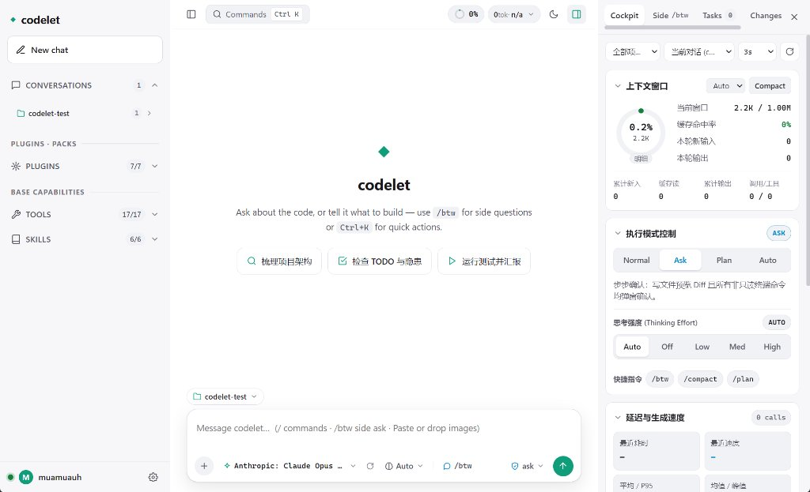
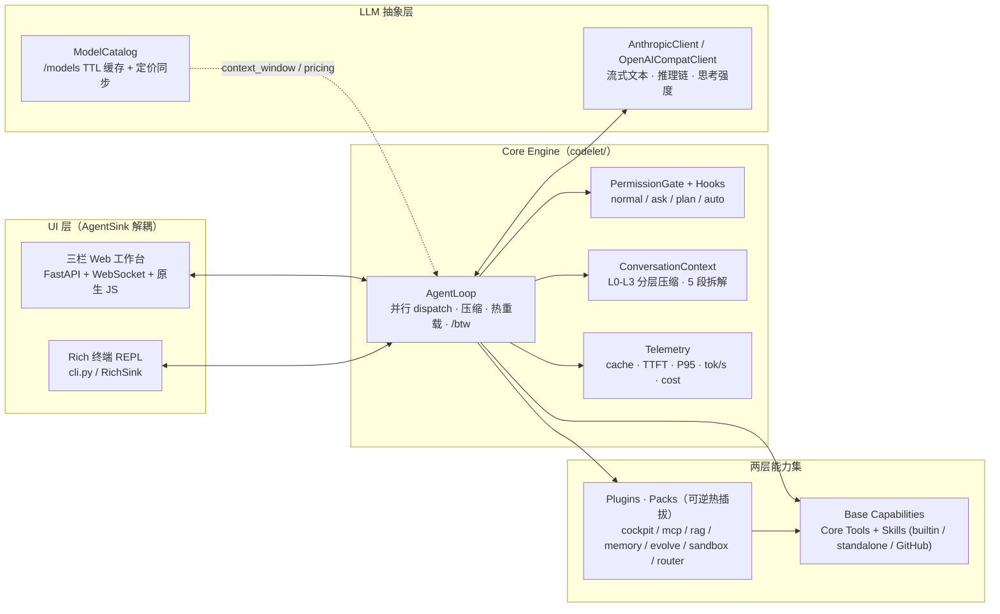

<div align="center">


<h1>codelet</h1>

<p><strong>轻量、透明、可扩展的 AI 编码助手框架、三栏 Web 工作台与 Windows 桌面客户端</strong></p>

<p>
  异步并行 Agent Loop · 原生 Cockpit 监控驾驶舱 · 四档权限与思考强度调节 · /btw 隔离侧栏问答 · 两层能力集（Plugins + Tools/Skills）· Windows 桌面版（DPAPI 加密设置 / 自动更新 / 右键打开）
</p>

<p>
  
  
  
  
  
  
</p>

<p>
  <strong>简体中文</strong> | <a href="./README_EN.md">English</a>
</p>

<p>
  <a href="#界面预览">界面预览</a> |
  <a href="#核心功能">核心功能</a> |
  <a href="#执行模式与思考强度">执行模式</a> |
  <a href="#两层能力集与插件">插件与技能</a> |
  <a href="#快速开始">快速开始</a> |
  <a href="#架构设计">架构设计</a> |
  <a href="#评测与测试">评测与测试</a> |
  <a href="#深入文档">深入文档</a>
</p>

</div>

---

> **设计理念**：核心代码精简透明（≤ ~3000 行），每一处工程取舍都有明确动机与文档说明；通过极小的 `AgentSink` 协议将核心 `AgentLoop` 与交互界面解耦，一套引擎同时驱动 **Rich 终端 REPL** 与 **零构建链原生三栏 Web 工作台**；默认兼容 Anthropic 原生与任意 OpenAI 协议服务端点（DeepSeek / OpenRouter / Ollama / vLLM 等）。

## 界面预览

<div align="center">
  
  <br />
  <sub><strong>三栏可拖拽工作台与 Windows 桌面客户端 · 左侧会话与两层能力集 · 中栏流式对话与一体化输入卡片 · 右侧 Cockpit / Side /btw / Tasks / Changes</strong></sub>
</div>

## 核心功能

| 模块 | 核心能力 |
| :--- | :--- |
| **异步并行 Agent Loop** | 原生 `asyncio` 驱动，单轮多 `tool_use` 经 `asyncio.gather` 并发执行并严格按原始顺序回填，单个工具异常自动隔离不拖垮整轮；支持实时 Token / 推理链（`reasoning_delta` / `thinking_delta`）流式输出与生成中随时 **Stop** 中断。 |
| **原生 Cockpit 驾驶舱** | 内置 `cockpit` 插件（默认启用）：顶部支持按项目筛选、历史会话检视与自动刷新间隔（`3s/5s/10s/30s`）；SVG 上下文环形仪表盘 + 5 段悬浮构成明细 + 一键 `/compact`；缓存命中率与累计消耗；TTFT / 均值 / P95 延迟与 `tok/s` 近 24 轮趋势图；跨会话今日 / 7 日消费统计与模型分布（不绑定特定中转站余额）。 |
| **桌面客户端与三栏工作台** | 提供 **Windows 独立桌面版**（Electron + 内置 PyInstaller 后端，零 Python 环境开箱即用）：支持关闭窗口时询问「最小化到托盘 / 直接退出」并记忆偏好、资源管理器右键“Open with codelet”、带实时下载进度条的 `electron-updater` 自动更新与按 commit 自动分类的英文 Release Notes；左下角内置四分区 **设置中心（通用 / 模型与接口 / 插件 / 关于）**，支持中英双语即时切换、Agent/上下文参数自定义、Windows DPAPI 加密存储 API Key、提供商卡片式管理、模型目录自定义与中转站 AI 读文档发现模型；一体化输入卡片、按工作区分组的会话列表及按工作区独立记住执行模式、思考强度、插件/工具/技能与折叠状态。 |
| **`/btw` 隔离侧栏问答** | 独立上下文旁路提问面板（Web 右侧 `Side /btw` Tab + CLI `/btw`），可附带主对话只读快照但**绝不污染主上下文**，即使主回合正在运行中也可以并发提问。 |
| **动态模型目录与多 Provider** | 自动从 OpenAI 兼容端点（`GET /v1/models`）拉取最新模型目录并本地 TTL 缓存（默认 24h），带搜索、厂商分组、上下文窗口 / 价格 / Vision / Reasoning 能力标签与一键刷新；定价与上下文上限自动同步到遥测与压缩预算。 |
| **四层上下文压缩与 SubAgent** | L0 超长输出落盘 → L1 零 LLM 清理旧工具结果 → L2 七节结构化滚动摘要（以服务商 `input_tokens` 为锚，保留 todo 列表）→ L3 保持 `tool_use/tool_result` 配对的硬上限；支持 `task` 并行子代理（深度上限 2、隔离上下文）。 |
| **GitHub Skill 安装与 Creator** | 同时支持扁平 `*.md` 与目录包 `<name>/SKILL.md`；贴入 GitHub 链接即可通过 `install_skill` / `/install` 拉取、审计脚本安全并**热重载**；内置 **`skill-creator`** 与 **`plugin-creator`** + `create_plugin_pack`，按自然语言即可生成并原地热挂载完整插件包。 |

---

## 执行模式与思考强度

### 四档权限模式（`--mode` / `/mode` / UI 实时切换）

| 模式 | 定位 | 文件写入 / 编辑 | 终端命令 (`bash`) | 适用场景 |
| :--- | :---: | :--- | :--- | :--- |
| **`normal`** | 标准协同 | 预览 Diff 并等待确认 | 常用安全开发命令自动放行，其余确认 | 日常高效编码与调试 |
| **`ask`** | 步步确认 | 预览 Diff 并等待确认 | 所有非只读命令均弹窗 / 提示确认 | 关键代码与谨慎改动（默认） |
| **`plan`** | 只读规划 | 硬拦截（白名单机制） | 仅放行只读查询命令，拒绝任何写入 | 架构调研、方案设计、高风险仓库 |
| **`auto`** | 全自动执行 | 自动批准执行 | 自动执行（仍强制拦截 `denied_patterns` 高危红线） | 明确边界内的连续批处理任务 |

### 五档可调思考强度（`--effort` / `/effort` / `Think` 胶囊 / Cockpit）

| 档位 | 说明 | 底层协议映射 |
| :--- | :--- | :--- |
| **`auto`**（默认） | 跟随当前模型默认思考策略 | 不附加参数，保持上游默认 |
| **`off`** | 关闭思考链，最低延迟与成本 | OpenAI 兼容端点传 `reasoning_effort="none"`；Anthropic 不启用 `thinking` |
| **`low`** | 轻度思考，适合常规小改与问答 | OpenAI 兼容端点 `low`；Anthropic `budget_tokens=2048` |
| **`medium`** | 中度思考，平衡推理质量与速度 | OpenAI 兼容端点 `medium`；Anthropic `budget_tokens=6144` |
| **`high`** | 深度思考，适合架构设计与疑难排查 | OpenAI 兼容端点 `high`；Anthropic `budget_tokens=12288` |

> 对不支持思考强度参数的普通模型，客户端会自动捕获上游拒绝并静默降级重试，不会导致回合中断。

---

## 两层能力集与插件

codelet 采用清晰的两层能力架构，左侧栏直观分区、全部支持会话中热插拔：

- **上层 · Plugins（功能包层）**：将一组相关的 `Tools + Skills + Commands + Panels + Middleware + TurnPolicy` 捆绑为可一键启停的功能包，支持 `*.py` 单文件、entry points 以及目录包 `.codelet/plugins/<name>/`（`plugin.py` + `skills/`）。每个插件拥有**可逆生命周期句柄（`PluginHandle.dispose()` / `ctx.effect()`）**与可选 **`requires` 依赖拓扑排序 + 级联卸载**，勾选或切换滑动开关即可在原 `AgentLoop` 上原地热插拔，零状态丢失；插件还支持声明 **`settings_schema`** 自动在 **设置 → 插件** 生成专属配置表单（保存后自动热重载），以及通过 `ctx.register_panel()` 向右侧 Inspector 动态注册专属 UI 面板。
- **底层 · Base Capabilities（原子能力层）**：`Tools`（按 `Core / From plugins / Self-evolved` 分组）与 `Skills`（按 `Built-in / From plugins / Standalone · Project / Standalone · Global` 分组），支持细粒度单独开关。

### 内置插件一览

| 插件 | 默认 | 捆绑工具 / 技能 / 命令 / 面板 | 核心能力 |
| :--- | :---: | :--- | :--- |
| **`cockpit`** | ✅ 启用 | `cockpit_status` · `✦ session-diagnostics` · `/cockpit` | 上下文 5 段监控、缓存命中、速度/延迟曲线与跨会话消费统计 |
| **`mcp`** | 可选 | `mcp__<server>__*` · `✦ mcp-usage` · `/mcp` · `◫ MCP` | 零外部依赖 MCP 桥接（支持 `stdio` 本地子进程与 `http`/SSE），卸载自动清理子进程 |
| **`rag`** | 可选 | `search_docs` · `✦ workspace-research` · `/rag` | 本地纯 Python BM25 全文检索（无外部 embedding API 依赖） |
| **`memory`** | 可选 | `memory` · `✦ memory-hygiene` · `/memory` | 跨会话有类型 Markdown 记忆（项目级 / 用户级），按 key 覆写、拒存密钥 |
| **`evolve`** | 可选 | `create_tool` · `create_plugin_pack` · `/evolve` | 自进化与 Creator 模式：现场编写单工具或完整目录型插件包并原地热挂载 |
| **`sandbox`** | 可选 | `sandbox` | 在一次性无网络 Docker 容器中隔离执行高风险命令（挂载 `/workspace`） |
| **`router`** | 可选 | `TurnPolicy` | 意图路由：自动将问答 / 规划类回合收紧为只读，防止擅自改文件 |

### 新安装 Skill 的三路自动归类

1. **随插件捆绑**：放入 `.codelet/plugins/<pack>/skills/` 或通过 `install_skill(scope="plugin", plugin="<pack>")` 安装，随插件热插拔；
2. **Frontmatter 声明**：在 YAML 头写可选的 `plugin: <name>`（随对应插件启停）或 `category: <tag>`（如 `review / testing / ops`）；
3. **零配置独立安装**：直接放入 `.codelet/skills/` 或 `~/.codelet/skills/`，自动归入 `Standalone · Project` / `Standalone · Global`，写完或 `/install` 后自动热重载立即生效。

---

## 快速开始

### 方式 A：直接下载 Windows 桌面客户端（推荐，零 Python 环境）

前往 [GitHub Releases](https://github.com/muamuauh/codelet/releases/latest) 下载适合你的安装包：

| 安装包 | 说明 |
| :--- | :--- |
| **`codelet-Setup-x.y.z.exe`**（推荐） | 标准 Windows 安装程序（默认装到用户目录、免管理员权限、自动创建桌面/开始菜单快捷方式、注册资源管理器右键 **Open with codelet**、冷启动最快、支持 `electron-updater` 自动更新） |
| **`codelet-x.y.z-portable.exe`** | 单文件便携版，下载后双击即用，不写入安装记录 |
| **`codelet-x.y.z-win-x64-unpacked.zip`** | 解压即用目录版，解压后直接运行 `codelet.exe` |

打开后点击左下角设置齿轮图标（**设置中心**），在 **模型与接口** 中添加或编辑提供商（支持 OpenAI / Anthropic / DeepSeek / Kimi / ZenMux / OpenRouter 等内置目录或任意自定义兼容 API），填入 `API Key`（通过 Windows DPAPI 加密保存，绝不落明文）即可开用；还可在 **通用** 中切换中英双语、主题与关闭窗口行为，在 **插件** 中可视化启停并配置每个插件的专属参数，在 **关于** 中查看版本号与一键检查更新。

### 方式 B：从源码运行（CLI / Web / 桌面开发模式）

> Windows + miniconda 详细实操与排坑指南见 [USAGE.md](./USAGE.md)。

#### 1. 安装环境

```bash
conda create -n codelet python=3.10 -y
conda activate codelet
pip install -e ".[dev,web]"
```

### 2. 配置 LLM（最快只需 `.env` 三行）

```bash
cp .env.example .env
```

```ini
# .env — 兼容任意 OpenAI 协议端点（DeepSeek / OpenRouter / Ollama / 自建网关等）
LLM_BASE_URL=https://api.deepseek.com/v1
LLM_API_KEY=sk-xxx
LLM_MODEL=deepseek-chat
# LLM_PROVIDER=openai   # 默认 openai；使用 Anthropic 原生时设 anthropic
```

> Shell 导出的环境变量优先级高于 `.env`；也可在 [`.codelet/settings.json`](./.codelet/settings.json) 中配置多套命名 `profiles` 并通过 `--profile <name>` 切换。解析优先级：`CLI 参数 > --profile > settings.json > .env (LLM_*) > anthropic`。

### 3. 启动 Web 工作台或 CLI

```bash
# 启动本地三栏 Web 工作台（自动打开浏览器；加 --no-open 禁用自动打开）
python -m codelet.web
# 或一键脚本：./run-web.ps1 (Windows) / ./run-web.sh (macOS/Linux)

# 启动终端交互式 REPL
python -m codelet

# 一次性任务 / 指定模式与思考强度
python -m codelet --mode normal --effort medium "在当前目录找出所有 TODO 注释"

# 恢复历史会话
python -m codelet --resume <session-id>
```

### 常用内置 Slash 命令（Web & CLI 通用）

| 命令 | 作用 |
| :--- | :--- |
| `/models [kw\|refresh]` · `/model [id]` | 查看 / 搜索 / 刷新模型目录，或切换当前模型 |
| `/mode [normal\|ask\|plan\|auto]` | 切换四档权限模式 |
| `/effort [auto\|off\|low\|medium\|high]` | 切换五档思考强度 |
| `/btw <question>` | 在隔离侧栏发起旁路提问（不污染主上下文） |
| `/compact [focus]` · `/clear` | 手动压缩上下文（可指定保留重点）/ 清空新开会话 |
| `/install <github-url> [--global] [--plugin <pack>]` | 从 GitHub 拉取并安全审计、热安装 Skill |
| `/cockpit [refresh]` · `/cost` · `/usage` | 打开 Cockpit 监控面板 / 查看会话与 7 日消费统计 |
| `/diff` · `/todos` · `/export` | 查看 Git 变更 / 任务清单 / 导出对话为 Markdown |
| `/tools` · `/skills` · `/commands` · `/sessions` · `/resume <id>` | 查看能力集与会话管理 |

---

## 架构设计



### 目录结构

```text
codelet/
├── assets/logo.svg                    # 项目图标
├── codelet/
│   ├── agent_loop.py                  # 异步主循环、并行 dispatch、热重载、/btw 与审批流
│   ├── cli.py                         # Rich 终端 REPL 与 CLI 入口
│   ├── config.py / settings.py        # 配置模型、.env / settings.json 分层加载与 profile 解析
│   ├── context.py                     # L0–L3 分层上下文压缩、5 段占用拆解、CLAUDE.md 加载
│   ├── permissions.py                 # 两层权限门（高危规则 + 四档模式）
│   ├── telemetry.py                   # Token / 缓存命中 / TTFT / P95 / tok/s / 成本统计
│   ├── events.py                      # AgentSink 协议（CLI 与 Web 解耦边界）
│   ├── llm/                           # Anthropic / OpenAI-compat 客户端与动态 ModelCatalog
│   ├── plugins/                       # 可逆插件句柄、requires 拓扑加载与 7 个内置插件（含 cockpit / mcp）
│   ├── skills/                        # 扁平 & SKILL.md 加载器、GitHub installer、内置 skill/plugin-creator
│   ├── tools/                         # 核心工具（file / bash / glob / grep / web_fetch / skill / task / todo / install_skill）
│   ├── hooks/                         # PreToolUse / PostToolUse / UserPromptSubmit shell hooks
│   ├── persistence/                   # 原子 Session 持久化与项目级会话注册表
│   ├── subagent/                      # 上下文隔离并行子代理
│   └── web/                           # FastAPI + WebSocket 后端与零构建链三栏前端（含设置中心与动态插件面板）
├── desktop/                           # Electron Windows 桌面客户端（DPAPI 密钥库 / 托盘 / 实时进度更新 / 打包脚本）
├── evals/                             # 本地任务评测、压缩保留评测、记忆/路由评测、SWE-bench Lite 适配器
├── docs/                              # 架构图、时序图、技术细节、插件架构与面试 Q&A
└── tests/                             # 361 项单元与 WebSocket 端到端测试
```

---

## 评测与测试

```bash
# 运行全部单元与端到端集成测试（361 passed）
pytest -q

# 运行本地执行式任务评测（evals/tasks/*.yaml）
python -m evals.runner

# 运行 SWE-bench Lite stage-1 预测生成（--gold 可零成本冒烟测全链路）
python -m evals.swebench.run_swebench --gold --limit 5
```

- **全量回归测试**：`361 passed`（覆盖核心 Loop、权限、压缩、遥测、模型目录、设置中心与插件配置热重载、Cockpit、MCP stdio 桥接、可逆 `dispose()` / 级联卸载、Creator 插件包、`/btw`、思考强度、GitHub Skill 安装器、Release Notes 自动分类生成与 WebSocket 端到端流程）。
- **专项评测成果**：上下文结构化压缩保留率 `59/60`（摘要输入省约 80%）；跨会话记忆纠偏遵守率 `3/20 → 19/20`；意图路由误改率 `1/16 → 0/16`；SWE-bench Lite 实测详见 [`evals/swebench/README.md`](./evals/swebench/README.md)。

---

## 深入文档

| 文档 | 内容 |
| :--- | :--- |
| [USAGE.md](./USAGE.md) | Windows + miniconda 实操指南与常见排坑 |
| [docs/architecture.md](./docs/architecture.md) | 模块责任划分与扩展点 |
| [docs/plugin-architecture.md](./docs/plugin-architecture.md) | 插件接口、两层能力集与六大内置插件详解 |
| [docs/flow-diagrams.md](./docs/flow-diagrams.md) | 9 张 Mermaid 运行时核心路径时序图 |
| [docs/technical-details.md](./docs/technical-details.md) | 12 个易踩坑的实现细节 |
| [docs/interview-qa.md](./docs/interview-qa.md) | 30 个 Agent 工程设计权衡 Q&A |
| [docs/evaluation.md](./docs/evaluation.md) | 评测框架设计与过程指标 |

---

## License

MIT © 2026 [muamuauh](https://github.com/muamuauh)
