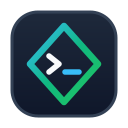
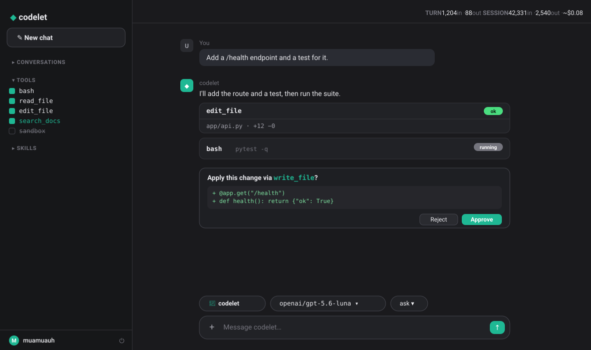
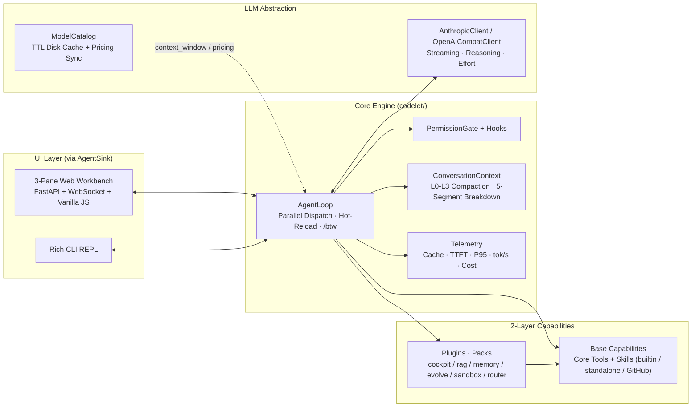

<div align="center">



<h1>codelet</h1>

<p><strong>Lightweight, Transparent, Extensible AI Coding Agent Framework &amp; Local 3-Pane Web Workbench</strong></p>

<p>
  Async Parallel Agent Loop · Native Cockpit Telemetry · 4 Modes &amp; 5 Thinking Efforts · Isolated /btw Side Q&amp;A · 2-Layer Capabilities · GitHub Skill Hot-Install
</p>

<p>
  
  
  
  
  
  
</p>

<p>
  <a href="./README.md">简体中文</a> | <strong>English</strong>
</p>

<p>
  <a href="#preview">Preview</a> |
  <a href="#key-features">Key Features</a> |
  <a href="#modes--thinking-effort">Modes &amp; Effort</a> |
  <a href="#two-layer-capabilities">Plugins &amp; Skills</a> |
  <a href="#quick-start">Quick Start</a> |
  <a href="#architecture">Architecture</a> |
  <a href="#evaluations--tests">Tests</a>
</p>

</div>

---

> **Design Philosophy**: Keep the core agent loop compact and readable (~3,000 LOC) with every design trade-off documented. A minimal `AgentSink` protocol decouples `AgentLoop` from UI rendering so one engine drives both a **Rich CLI REPL** and a **zero-build 3-pane local Web Workbench**. Works natively with Anthropic and any OpenAI-compatible endpoint (DeepSeek, OpenRouter, Ollama, vLLM, etc.).

## Preview

<div align="center">
  
  <br />
  <sub><strong>Resizable 3-Pane Workbench · Conversations &amp; 2-Layer Capabilities · Streaming Chat &amp; Diff Approval · Cockpit / Side /btw / Tasks / Changes</strong></sub>
</div>

## Key Features

| Module | Capabilities |
| :--- | :--- |
| **Async Parallel Agent Loop** | Native `asyncio` loop dispatching multiple tool calls concurrently via `asyncio.gather` while preserving exact `tool_use` order and isolating per-tool errors; streams text & reasoning deltas (`reasoning_delta` / `thinking_delta`) with instant **Stop** cancellation. |
| **Native Cockpit Plugin** | Default-enabled `cockpit` plugin featuring a live SVG context ring + 5-segment hover breakdown (`system / tools / assistant / user / free`) + one-click `/compact`, prompt cache hit rate, TTFT/Avg/P95 latency & `tok/s` 24-turn trend charts, and cross-session today / 7-day spend & model distribution charts (with optional provider balance integration). |
| **Resizable 3-Pane Web Workbench** | Pure HTML/CSS/JS (no build chain, bound to `127.0.0.1`) with draggable left/right panes (persisted in `localStorage`, double-click to reset), topbar context gauge pill, `Ctrl+K` global command palette, light/dark themes, image paste/drag-drop multimodal input, drive-root workspace switcher, and Git Changes + colored diff viewer. |
| **Isolated `/btw` Side Q&A** | Dedicated side-panel Q&A (`Side /btw` tab & CLI `/btw`) with optional read-only main-context snapshot — **never mutates main conversation messages** and runs concurrently even while a main turn is busy. |
| **Dynamic Model Catalog** | Periodically fetches models from OpenAI-compatible endpoints (`GET /v1/models`) with local TTL disk cache, searchable picker, vendor tabs, context length / pricing / vision / reasoning badges, and automatic pricing + context-window sync. |
| **4-Layer Compaction & SubAgents** | L0 large-output spill → L1 zero-LLM old tool output clearing → L2 7-section structured rolling summary (usage-anchored, preserving todos) → L3 pair-safe hard ceiling; parallel isolated `task` subagents (max depth 2). |
| **GitHub Skill Hot-Install & Creator** | Supports both flat `*.md` and `<name>/SKILL.md` bundles (`scripts/`, `references/`); paste any GitHub URL or run `/install <url>` for frontmatter normalization, script security audit, and instant hot-reload; ships with built-in **`skill-creator`** to author new skills from natural language. |

---

## Modes & Thinking Effort

### 4 Permission Modes (`--mode` / `/mode` / UI Switcher)

| Mode | File Edits | Shell Commands (`bash`) | Best For |
| :--- | :--- | :--- | :--- |
| **`normal`** | Unified diff approval | Safe dev commands auto-run; others confirm | Everyday collaborative coding |
| **`ask`** *(default)* | Unified diff approval | All non-read-only commands confirm | Cautious changes on sensitive repos |
| **`plan`** | Hard-blocked (allowlist) | Read-only inspection commands only | Exploration & architecture planning |
| **`auto`** | Auto-approved | Auto-run (hard `denied_patterns` guard stays on) | Fast autonomous batch edits |

### 5 Thinking Effort Levels (`--effort` / `/effort` / `Think` Pill / Cockpit)

- **`auto`** *(default)* — follows the upstream model's default reasoning behavior
- **`off`** — disables reasoning (`reasoning_effort="none"` on OpenAI-compatible endpoints; omits Anthropic `thinking`)
- **`low` / `medium` / `high`** — maps to `reasoning_effort` on OpenAI-compatible endpoints and `thinking.budget_tokens` (`2048 / 6144 / 12288`) on Anthropic, with automatic fallback retry for non-reasoning models.

---

## Two-Layer Capabilities

- **Upper Layer · Plugins (`Plugins · Packs`)**: Hot-pluggable feature packs bundling `Tools + Skills + Commands + Middleware + TurnPolicy`. Supports single `*.py` files, Python entry points, and directory bundles (`.codelet/plugins/<name>/` with `plugin.py` and/or zero-code `skills/*.md`).
  - Built-in plugins: **`cockpit`** *(default on)*, **`rag`**, **`memory`**, **`evolve`**, **`sandbox`**, **`router`**.
- **Base Layer · Capabilities (`Tools` & `Skills`)**: Fine-grained toggles grouped by origin (`Core / From plugins / Self-evolved` for tools; `Built-in / From plugins / Standalone · Project / Standalone · Global` for skills). Newly installed skills automatically classify via plugin bundle, optional frontmatter (`plugin:` / `category:`), or zero-config standalone scope.

---

## Quick Start

```bash
conda create -n codelet python=3.10 -y
conda activate codelet
pip install -e ".[dev,web]"

cp .env.example .env
# Edit .env: set LLM_BASE_URL, LLM_API_KEY, LLM_MODEL
```

```bash
# Launch local 3-pane Web Workbench
python -m codelet.web

# Launch interactive CLI REPL
python -m codelet

# One-shot prompt with mode & thinking effort
python -m codelet --mode normal --effort medium "Audit TODOs across this repo"
```

---

## Architecture



---

## Evaluations & Tests

```bash
pytest -q                                        # 335 passed
python -m evals.runner                           # local task eval suite
python -m evals.swebench.run_swebench --gold --limit 5
```

Deep-dive docs (in Chinese): [USAGE.md](./USAGE.md) · [docs/architecture.md](./docs/architecture.md) · [docs/plugin-architecture.md](./docs/plugin-architecture.md) · [docs/flow-diagrams.md](./docs/flow-diagrams.md) · [docs/technical-details.md](./docs/technical-details.md) · [docs/interview-qa.md](./docs/interview-qa.md).

---

## License

MIT © 2026 [muamuauh](https://github.com/muamuauh)
